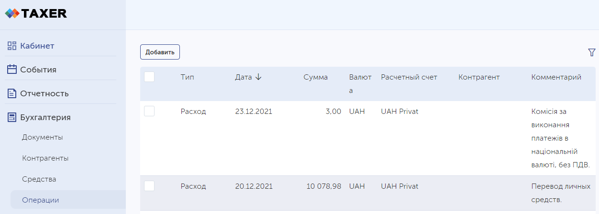

# Archived
## https://taxer.ua/uk/kb/synkhronizatsiia-vypysky-z-pryvatbank

# Импорт выписок из Privat24 business в taxer.ua

Позволяет ~~втупую~~ загрузить выписки в xls формате в taxer. That's pretty much it 😅.

Умеет заполнять [операции](https://taxer.ua/ru/my/finances/operations):
- Доход/расход
- Дата/время транзакции
- Сумма и счёт
- Комментарий
  
Контрагента по счету из xls слишком долго и неудобно парсить, так что нет 😔

## How to

1) `git clone https://github.com/unickq/privat24-taxer.git`
2) `npm install`
3) cоздаем и заполняем `.env` файл. Пример - `example.env`
4) `npm start`

### Privat24

1) Зайти в [Приват24 для бизнеса](https://24.privatbank.ua/)
2) Выбрать **Cчета и выписки** 
3) Выбрать необходимый промежуток времени и экспортнуть в **xls**
4) Сохранить файл в `data\filename.xls` и добавить `XLS_FILE_NAME=filename.xls` в `.env` файл

### Taxer 

##### Cookie

1) Залогиниться в [Taxer](https://taxer.ua/)
2) Получить `document.cookie` в консоли браузера и добавить `TAXER_COOKIE=` в `.env` файл

##### Bank account id

1) Зайти в [Бухгалтерия -> Средства](https://taxer.ua/ru/my/finances/accounts)
2) Добавить id аккаунта `TAXER_BANK_ID=` в `.env` файл

##### FOP accound id

1) Зайти на любую страницу [taxer](https://taxer.ua/) с включенными *Network* в devtools
2) Найти в responce запроса `api/user/login/load_account`
3) В массиве **users** выбрать необходимый счет и сохранить его **id** в  `TAXER_FOP_ID=` в `.env` файл

### Credits:
[@maxsivkov](https://github.com/maxsivkov) и его python [py-pbank-statements](https://github.com/maxsivkov/py-pbank-statements) и [py-taxer-api](https://github.com/maxsivkov/py-taxer-api), ~~которые я так и смог заставить работать, из-за чего и написал свой node~~ 🚲
